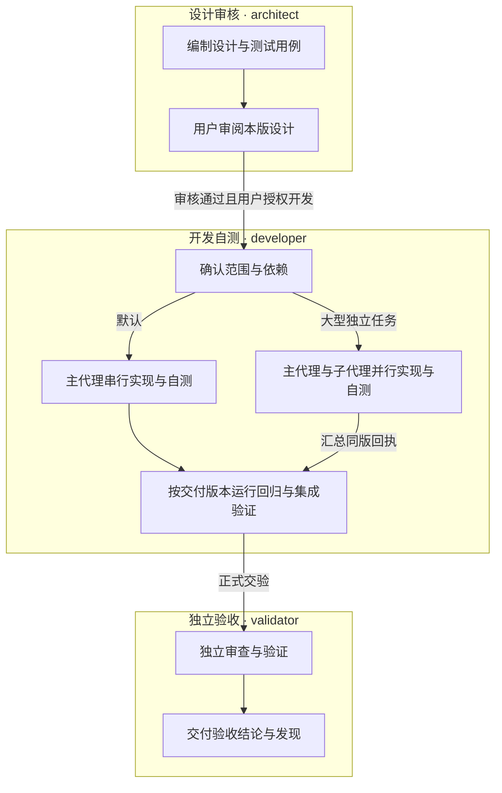

# agent-tools

适用于 Codex 和 Claude Code 的插件市场，提供软件设计、开发和技术验收工具。

## 工作流

从需求开始时，依次经过设计审核、开发自测和独立验收。已有经用户审核通过的设计，可直接从开发阶段开始；已有待验版本，可直接从验收阶段开始。



**设计审核。** 成稿交付时，用户可以要求修改、只接收设计，或回复“按这版开发”。若已提前约定审核通过后开工，本版通过即可按原范围实施。

**开发自测。** 只有至少两项大型工作能独立实施和自测、写入范围互不冲突，且扣除协调与验收开销后仍能明显提前交付，才启用并行。主代理先读共用依赖再派工，子代理继承开发上下文，各自读本包详设并自测。主代理复用同版有效回执，统一交验。用户明确只需自测时，交付自测结果即结束。

**独立验收。** developer 交验时启动新的独立 validator。直接调用 validator 时，干净会话可就地验收；参与过开发、继承了开发上下文或无法确认独立性时，由新的独立子代理验收。用户明确只要复核时，就地交付发现，保留原报告和验收状态。

验收允许写入时，`PASS`、`FAIL`、`INCOMPLETE` 均记录在 `tests/test-report.md`。仅要求验收时止于结论。任务已授权继续处理时，设计缺项由 architect 补齐并交用户重审，实现或测试缺陷由 developer 修复并自测，新版本再交新的独立 validator 复验。

## 安装

在对应宿主中添加 GitHub 插件市场，按需安装插件。开发后需要独立验收时，同时安装 engineer 和 inspector。

### Codex

```sh
codex plugin marketplace add lightcodehub/agent-tools
codex plugin add designer@agent-tools
codex plugin add engineer@agent-tools
codex plugin add inspector@agent-tools
```

### Claude Code

```text
/plugin marketplace add lightcodehub/agent-tools
/plugin install designer@agent-tools
/plugin install engineer@agent-tools
/plugin install inspector@agent-tools
```

## 使用

| 插件 | 调用入口 | 用途 |
| --- | --- | --- |
| [designer](plugins/designer/README.md) | `/designer:architect` | 编制技术方案和设计文档，补齐存量项目设计。 |
| [engineer](plugins/engineer/README.md) | `/engineer:developer` | 按设计实现或修复代码，编写测试、自测并交验。 |
| [engineer](plugins/engineer/README.md) | `/engineer:discover-skills` | 将项目已有的 skill 注册到指定宿主。 |
| [inspector](plugins/inspector/README.md) | `/inspector:validator` | 审查已有实现，执行独立技术验收或按要求复核。 |
