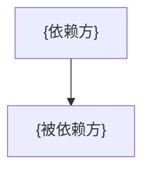

# {项目或已明确子系统名称} — 总体设计

<!-- 命令、路径、标识符、正则和样例字面值使用代码格式，核对 Markdown 解析后字符完整；正文中的当前事实与实际代码、测试及状态一致，不以状态标签代替事实同步。成稿删除此提示。 -->

<!-- 本文承载概要设计和代码架构设计；以模块、层、包和组织边界表达架构，具体实现文件、类、函数及源码证据在模块文档维护。仅文件本身确为独立架构模块时可注明文件名，不因可导入就认定为独立模块。正文不重复模块待实现状态，规划与实际组织分清；成稿删除注释与填写提示。 -->

> 设计时间: {YYYY-MM-DD}
>
> 需求依据: {需求资料引用或已确认的设计目标}
>
> 设计基线: {已核实的代码版本、需求版本或目标版本；没有明确版本时省略，不编造}

## 1. 设计目标与范围

**项目定位**: {项目整体提供的能力和使用边界；依据已有资料简要说明，不以单个函数或修复任务代替项目背景}

**设计目标**: {整体需要达到的功能与技术结果；不展开局部实现缺陷或具体算法}

**覆盖范围**: {本设计涉及的能力、系统边界及对已有能力的影响}

**不在范围**: {明确排除的能力或内部设计}

<!-- 单模块项目也保持总体与详细设计的层次，内容可以简短。局部需求沿用已有总设计，只更新受影响内容，不重写无关模块；背景资料不足时明确已知范围和待确认事项。 -->

## 2. 总体方案

### 2.1 整体实现思路

{实现目标的总体方案、主要输入输出及运行方式；不重复模块内部算法和字段校验}

### 2.2 主要处理链路

{从输入到输出的主要功能流程、模块协作及关键数据流；复杂关系使用流程图或时序图，简单项目可用简短说明}

### 2.3 关键设计选择（按需出现）

| 选择 | 采用方案 | 依据与影响 |
| --- | --- | --- |
| {需要解释的架构选择} | {确定方案} | {与需求、现有能力或约束的关系及实际取舍} |

## 3. 代码架构

### 3.1 模块与代码组织

<!-- 本节同时承担导航：职责摘要可定位需求，详细设计链接指向真实模块文档；必要时增加其已有契约章节锚点。配合 §3.2 的模块依赖和 §3.3 的契约归属逐步定位，不复制模块正文、源码清单、派生状态或大模型读取计划。 -->

| 模块 | 职责摘要 | 模块归属与组织边界 | 详细设计 |
| --- | --- | --- | --- |
| {架构模块} | {承接的整体能力} | {所属层、包或必要目录边界；规划与现状分清，不列内部实现文件或函数} | [{模块名}](./{module}/index.md) |

**组织约束**: {实际或规划的模块、层和包之间的职责边界；表格已能表达时无需重复，目录树如有必要仅展示架构单元，不展开文件清单}

### 3.2 依赖与协作

<!-- 节点用架构模块名称，依赖方指向被依赖方；不以内部文件或函数作节点。协作说明表达调用方向、数据交接和外部边界，并链接必要契约，使读者能识别被依赖方及受影响调用方；不重复另建同内容的依赖清单。无依赖的模块只画节点，不照抄示意关系。 -->

**协作边界**: {实际调用方式、跨模块数据交接与外部交互边界；接口细节链接归属模块或外部契约}

### 3.3 公共能力与契约归属（按需出现）

| 能力或共享契约 | 归属模块或层 | 使用方及约束 | 详细设计 |
| --- | --- | --- | --- |
| {共享能力或契约} | {唯一维护模块，不列内部文件或函数} | {必要协作或兼容约束} | {指向定义章节的链接，显示该模块的实际章节标题；保留编号时写全“编号 标题”} |

### 3.4 依赖检查

**结论与依据**: {实际核验的模块范围、依赖依据及环检测结论；区分索引图与源码依赖核对，只验子图不宣称全项目无环；有环时列出模块环路和影响，不预填检查通过}

## 4. 项目约束

<!-- 只写有依据且实际适用的约束，区分必须遵守的限制与可调整的设计选择；不为填表编造指标。模块特有约束写在模块 §7。 -->

| 约束项 | 必须满足的条件 | 来源或依据 | 影响范围及核验方式 |
| --- | --- | --- | --- |
| {技术栈、运行、性能、数据、安全或兼容方面的实际约束} | {具体条件、版本或阈值} | {可核对依据} | {受影响模块与核验方法或验收引用} |

## 5. 公共开发与验证约定

### 5.1 代码规范

<!-- 固定三列、八行、下列名称与顺序，不删减、合并、改名或改成段落。每行给出项目公共约定或有效引用、适用范围和真实核验方式；无对应机制也写明事实与边界，不留空或只写“不适用”。新项目明确采用的规则，存量区分成文规则与源码归纳。模块特有字段、校验、构造器、异常和状态流程下沉详细设计；不为填表引入机制或工具。 -->

<!-- 逐行做内容层级核验，不能只数行：单模块的业务规则也不是公共代码规范；局部命名/注释/实现现象不能归纳成全项目惯例。数量参数、具体数据类或依赖对象如何工作在模块契约定义，总表保留有依据的公共原则或引用。 -->

| 规范项 | 项目约定或有效引用 | 适用范围与核验方式 |
| --- | --- | --- |
| 规范依据与检查 | {新项目采用的规范；存量已核实规则或明确标识的源码归纳；真实配置/命令，没有工具时如实说明} | {实际覆盖范围与人工或工具核验方式，不用业务测试代替风格审查} |
| 命名与接口风格 | {命名规则、公开接口及内部实现的区分} | {实际适用代码} |
| 类型与数据约定 | {类型表达、空值、转换、可变性和校验责任原则；局部约束用模块链接，不写冻结数据类/容器/构造器等实现方式} | {类型检查或公共契约审查的范围与依据} |
| 错误处理 | {错误表达形式、捕获/转换责任与传播边界；可自然传播的情形} | {实际处理边界及模块契约引用} |
| 资源与执行 | {实际资源的取得/释放责任；适用的并发、异步、共享状态、取消和超时规则} | {生命周期核验与相关用例} |
| 配置与依赖使用 | {配置入口与默认值来源、已有库接口、依赖使用约束} | {实际配置和调用位置} |
| 日志 | {公共日志入口、记录边界与信息保护原则；具体事件/字段见模块契约；无日志需求时明确边界，不新增机制} | {实际适用范围、事件契约引用与核验方式} |
| 注释与接口说明 | {有依据的公开契约及非显然逻辑说明约定；未形成统一惯例时明确缺口，不以少数说明概括全部代码} | {现有或规划说明的真实适用范围；与接口契约核对，不虚称覆盖} |

### 5.2 测试约定

| 项目 | 约定或有效引用 |
| --- | --- |
| 框架与配置 | {实际框架、版本、根级配置文件和测试发现范围} |
| 根目录与运行入口 | {绝对项目根定位、入口及工作目录设置} |
| 源码格式与命名 | {合法后缀、UT/IT 文件及用例命名、辅助源码格式} |
| 全量验证命令 | {完整单元命令；有项目级集成命令时单列} |
| 运行与数据管理 | {唯一 run-id 及参数隔离、data/artifacts/datasets 配置、清理和保留策略；可引用已有完整项目约定} |
| 版本控制 | 根 `.gitignore` 包含 `/build/`；`build/` 无受跟踪文件 |
| 规范报告 | `tests/test-report.md` |

<!-- 合并正文与引用后须明确可执行命令、实际输出路径、数据集来源/版本/校验/缺失策略及必要例外；原有固定测试布局不变。较长说明可链接已有项目配置或按需附属文档，不逐模块复制，也不抄 skill 管理禁令。 -->

### 5.3 共享界面约定（按需出现）

- **设计依据**: {实际设计系统、样式资源或共享视觉文档的有效链接}
- **共同约束**: {项目支持的主题、组件复用及需跨模块一致的界面规则；模块特有布局与交互引用对应模块的界面设计章节}

<!-- 完整资料已有时直接引用；确需单独维护具体颜色/字号/间距等时，使用 visual-spec.md 模板输出附属文档并在此链接。不得为了总文档结构而新增视觉选型或复制一份已维护的数据。 -->

## 6. 风险与待确认事项

### 6.1 风险与应对

| 风险 | 影响范围 | 应对措施与必要恢复条件 | 相关设计或验证 |
| --- | --- | --- | --- |
| {影响总体方案或跨模块实施的实际风险} | {具体影响} | {缓解措施；适用时包含回滚或恢复条件} | {对应章节或验证依据} |

### 6.2 跨模块未决问题

| 问题 | 影响范围 | 需要确认的事项 | 确认方 |
| --- | --- | --- | --- |
| {影响总体方案或跨模块实施的问题} | {受阻决策} | {待确定的事实或参数} | {责任方} |

<!-- 风险或未决事项没有内容时用一句明确结论替代表格；模块内部问题放在模块 §11，不在总文档复制局部问题清单。 -->
