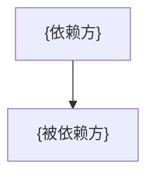

# {设计标题} — 总设计文档

<!-- 按 SKILL.md 的模板使用规则与产出文档表达规范填写；仅保留实际适用内容，成稿删除注释及填写提示。 -->

> 设计时间: {YYYY-MM-DD}
>
> 需求来源: {需求资料引用或业务目标摘要}

## 1. 背景与目标

**问题与影响**: {需要解决的问题及其影响}

**预期结果**: {预期行为与可验证结果}

## 2. 范围 / 非范围

**范围**:

- {交付能力}

**非范围**:

- {明确排除的能力}

**运行环境与兼容约束**:

- {实际技术栈、运行环境、版本和兼容范围}
- {需要保持的接口或数据兼容要求}
- {适用的性能或时限约束}

## 3. 项目约定

### 3.1 代码规范

- **命名与风格**: {项目命名约定、已有格式化或检查配置}
- **错误处理**: {错误类型、传播边界与处理方式}
- **日志**: {日志入口、等级与必要上下文}
- **注释**: {当前语言的注释规范与适用范围}

### 3.2 测试约定

| 项目 | 约定 |
| --- | --- |
| 框架与配置 | {实际框架、版本、根级配置文件和测试发现范围} |
| 根目录与运行入口 | {绝对项目根的定位方式、命令入口及工作目录设置} |
| 源码格式与命名 | {按实际语言列出合法后缀、UT/IT 文件及用例命名、辅助源码格式} |
| 全量验证命令 | {完整单元测试命令；存在项目级集成命令时单列} |
| 运行标识 | {唯一 run-id 的生成或传递方式；参数实例及并发隔离标识} |
| 临时数据 | `build/tests/runs/{run-id}/data/{module}/{case-id}/`；{框架临时目录配置} |
| 原始产物 | `build/tests/runs/{run-id}/artifacts/`；{日志、结构化结果及启用的覆盖率/缓存输出配置} |
| 资源清理与保留 | {各退出路径的回收机制、临时数据清理、诊断产物保留范围和期限} |
| 版本控制 | 根 `.gitignore` 包含 `/build/`；`build/` 无受跟踪文件 |
| 规范报告 | `tests/test-report.md` |

<!-- 路径变量应在运行标识等字段中解释其来源。共享数据集、辅助源码或位置例外仅在实际存在时增加项目条目；模块特有内容写入模块 §8。不在此复制 skill 执行规则或角色交接说明。 -->

## 4. 视觉规范（按需出现）

<!-- 按项目实际设计系统填写；没有依据的值列为未决项，不采用模板默认值。各表只保留实际使用的条目，主题按项目支持范围填写。 -->

> 状态: ⏳ 待实现

**设计依据**: {现有设计系统、样式文件或已确认的视觉要求}

### 色值表

| 色名 | 色值 |
| --- | --- |
| {项目实际颜色令牌} | {实际颜色值} |

### 语义映射

| 用途 | 主题 | 颜色令牌 |
| --- | --- | --- |
| {实际用途} | {项目主题名} | {对应颜色令牌} |

### 字体

| 用途 | 字号 | 单位 | 字重 |
| --- | --- | --- | --- |
| {实际用途} | {实际值} | {项目单位} | {实际值} |

### 间距

| 名称 | 值 | 单位 |
| --- | --- | --- |
| {项目令牌} | {实际值} | {项目单位} |

### 圆角

| 名称 | 值 | 单位 |
| --- | --- | --- |
| {项目令牌} | {实际值} | {项目单位} |

### 阴影

| 名称 | X 偏移 | Y 偏移 | 模糊 | 颜色令牌 | 单位 |
| --- | --- | --- | --- | --- | --- |
| {项目令牌} | {实际值} | {实际值} | {实际值} | {对应颜色令牌} | {项目单位} |

## 5. 模块索引与依赖关系

### 5.1 模块划分

| 模块 | 职责 | 文档 | 依赖模块 |
| --- | --- | --- | --- |
| {模块名} | {业务职责} | [{模块名}](./{module}/index.md) | {实际依赖模块} |

### 5.2 模块依赖图

<!-- 依据实际模块关系生成 Mermaid，箭头方向为依赖方指向被依赖方；无依赖的模块只画节点。成稿不保留此示意关系。 -->

### 5.3 循环依赖检查

**结论与依据**: {实际检查结论及支持结论的依赖关系；有环时列出环路和影响}

## 6. 风险与回滚

| 风险 | 概率 | 影响 | 缓解措施 |
| --- | --- | --- | --- |
| {实际风险} | {评估} | {影响范围} | {应对措施} |

**回滚方式**: {适用条件与恢复方式；不存在变更风险时说明依据，不编造风险}

## 7. 跨模块未决问题

| 问题 | 影响范围 | 需要确认的事项 | 确认方 |
| --- | --- | --- | --- |
| {实际问题} | {受影响模块或决策} | {待确定的规则或参数} | {责任方} |

<!-- 无未决问题时删除表格，保留一句明确结论；模块内部问题写在模块 §11。 -->
