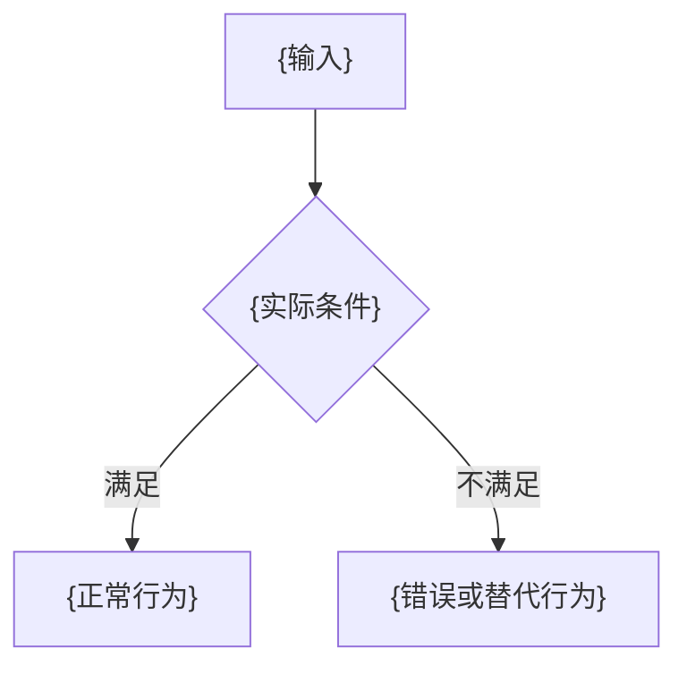

# 模块：{模块名称}

<!-- 命令、路径、标识符、正则和样例字面值使用代码格式，核对 Markdown 解析后字符完整；正文中的当前事实与实际代码、测试及状态一致，不以状态标签代替事实同步。成稿删除此提示。 -->

<!-- 按 SKILL.md 的模板使用规则与产出文档表达规范填写；省略不适用的可选章节或子节，保留编号，成稿删除注释与填写提示。 -->

> 设计时间: {YYYY-MM-DD}
>
> 实施时间: —
>
> 所属设计: [{设计标题}](../index.md)
>
> 模块状态: ⏳ 待实现

## 1. 模块概述

**职责与边界**: {模块负责的能力、明确排除的能力及与相邻模块的边界}

**实现依据（按需）**: {仅保留影响设计选择或调用方式的现状、限制与有效代码引用；目标与现状分开，不在此重复实施状态；已失效依据须原位清理，不记录修复经过}

**业务规则**: {判定条件、行为预期及适用限制}

<!-- 项目公共代码规范引用总文档 §5.1；本模块特有的参数校验、类型行为、错误、状态、资源恢复和事件契约在下述相应章节定义，不复制另一张公共规范表，也不将这些细节回填总表。 -->

### 1.1 依赖说明（按需出现）

<!-- 跨模块读写或状态变化须引用实际操作契约，优先指向具体章节或已有锚点；仅有类型或表结构不足以说明调用能力。写明所需能力及就绪条件，不复制被依赖模块全文；单元替身与集成前提分开。 -->

| 依赖模块 | 所需接口或类型 | 契约位置 |
| --- | --- | --- |
| [{模块名}](../{module}/index.md) | {实际依赖内容} | {具体章节或定义} |

### 1.2 调用方约束（按需出现）

<!-- 仅填写需要说明契约或变更影响的调用方，不复制总索引可直接推导的反向依赖表。 -->

| 调用方 | 使用方式 | 调用或兼容约束 |
| --- | --- | --- |
| [{模块名}](../{module}/index.md) | {实际接口或数据使用} | {需要满足的约束} |

### 1.3 外部依赖（按需出现）

| 服务 | 契约 | 运行时失败处理 |
| --- | --- | --- |
| {实际服务名} | [{接口名称}](../external-service/{service}/{api}.md#{anchor}) | {真实超时、重试、降级或错误返回行为} |

### 1.4 实现映射（按需出现）

<!-- 承接总文档下沉的具体代码位置。存量按真实代码填写；新项目只规划影响实施的关键映射，不为填表冻结全部内部文件。§3 定义接口，§8 定义测试源码，§9 引用实施位置，避免重复清单。 -->

| 实现位置 | 承担的职责与关键入口 | 依据或状态 |
| --- | --- | --- |
| {实际文件/类或必要规划位置} | {与本模块契约的对应关系，关键入口指向 §3} | {现有代码依据或明确的规划；不虚构已实现} |

## 2. 核心流程

<!-- 根据真实业务生成流程图；节点标签使用引号。复杂协作按需补充时序图，不复制示意节点。 -->

## 3. API 定义

### 3.1 HTTP 接口（按需出现）

#### `{METHOD} {实际路径}`

**行为与调用约束**: {用途、输入范围、空值规则及适用的鉴权、权限、幂等、超时要求}

| 参数 | 位置 | 类型 | 必填 | 约束 |
| --- | --- | --- | --- | --- |
| {实际参数} | {实际位置} | {项目类型} | {是或否} | {范围与校验规则} |

**返回**: {成功响应、字段定义或数据结构引用}

**错误行为**: {错误条件、状态码或错误码及响应含义}

### 3.2 函数/方法接口（按需出现）

#### `{项目语言的实际函数签名}`

| 参数 | 类型 | 约束 |
| --- | --- | --- |
| {实际参数} | {项目类型} | {范围与空值规则} |

**返回**: {实际返回类型、语义或数据结构引用}

**边界与错误行为**: {适用边界、异常或错误结果；涉及状态修改时说明副作用}

<!-- 按实际接口选择子节；事件、消息或命令接口按项目协议补充契约。无 HTTP 接口不生成 3.1；不得以没有 HTTP 接口为由省略实际调用入口。 -->

## 4. 数据结构（按需出现）

<!-- 仅描述新增、变更或需要单独解释的结构。使用项目语言的类型声明或下表；已有共享结构直接链接定义，不再重复声明。接口签名已完整表达简单类型时省略本节。 -->

### `{实际结构名}`

| 字段 | 类型 | 约束 | 含义 |
| --- | --- | --- | --- |
| {实际字段} | {项目类型} | {实际约束} | {业务含义} |

## 5. 数据库设计（按需出现）

<!-- 仅在涉及持久化结构时填写。表关系使用实际结构生成 ER 图；字段、主键、默认值、索引类型与数据库及项目约定一致，不预置 id、时间戳或自增策略。 -->

### 表关系

{实际关系与 ER 图；无表间关系时省略此子节}

### 表结构

#### `{实际表名}`

| 字段 | 类型 | 约束 | 含义 |
| --- | --- | --- | --- |
| {实际字段} | {数据库类型} | {实际约束} | {业务含义} |

### 索引（按需出现）

| 表 | 索引 | 字段 | 类型 | 用途 |
| --- | --- | --- | --- | --- |
| {实际表名} | {索引名称} | {字段} | {数据库支持的类型} | {查询或约束用途} |

### 结构与数据变更（按需出现）

{存在结构或数据变更时说明必要处理及既有迁移机制；特殊业务转换写明规则，不另加通用迁移操作手册}

## 6. 用户交互设计（按需出现）

### 组件与复用

| 层级 | 组件 | 职责 | 实际来源 | 选用依据 |
| --- | --- | --- | --- | --- |
| {实际层级} | {组件名} | {职责} | {已有或新增入口} | {满足需求的依据} |

### 界面与状态

- **页面结构**: {实际区域与布局；引用设计稿或线框图}
- **交互与状态**: {交互流程、组件通信、状态归属及异常状态}

## 7. 影响面与兼容性

- **影响范围**: {本模块及实际受影响的调用方、文件或配置}
- **兼容性**: {必须保持的行为、接口或数据约束}
- **模块特有约束**: {局部配置及默认值、性能或发布条件；没有时省略此项}

## 8. 测试设计

### 8.1 测试策略

**公共约定**: [项目测试约定](../index.md#52-测试约定)

- **模块单元命令**: {可执行的模块命令；命令与工作目录按公共约定解析}
- **真实调用与替身边界**: {被测逻辑、需要替身的具体依赖和替身行为}
- **模块特有条件**: {关键前置断言、运行条件及与公共约定不同且符合规范的配置；无则省略}

### 8.2 测试用例

<!-- 每个预期均须在该单元的真实/替身边界内可观察；创建或投递不等于下游执行完成。完整业务结果保留在对应模块或 §8.4 集成用例，且实施步骤结束时具备完整用例的运行条件。 -->

| 用例编号 | 行为或场景 | 输入 | 预期结果 | 类型 | 状态 |
| --- | --- | --- | --- | --- | --- |
| `{module}-UT-001` | {具体行为} | {可实施输入及参数实例} | {可断言结果} | {正常/边界/异常} | ⏳ 待实现 |

### 8.3 测试文件与数据

| 测试源码或辅助源码 | 覆盖目标或实际调用方 |
| --- | --- |
| `tests/{module}/unit/{符合命名规则的测试文件}` | {具体目标} |

<!-- 按实际需要增加 integration/support 路径；不生成空辅助目录。仅填写本模块的数据需求与例外，公共路径、命名、清理和 Git 约定通过 §8.1 引用，不重复抄写。 -->

- **数据准备**: {最小场景构造方式；确需文件时给出本模块具体 data 路径}
- **数据集依赖**: {仅有依赖时填写版本、路径及来源/校验/缺失策略，或链接项目级定义}
- **资源与位置例外**: {仅有额外资源或必要位置例外时填写隔离、清理及产物归档方式}
- **防护回归验证**: {仅有重要防护回归时填写受控副本或故障注入变体、触发输入、破坏的契约及预期失败；不把等价变体作为有效负向验证}

### 8.4 项目内集成验证（按需出现）

- **参与模块与真实调用范围**: {实际协作模块与必须使用真实实现的调用链}
- **替身边界**: {仍需替身的外部边界，不替换被验证的内部组合}
- **运行条件**: {具体就绪条件及必要数据准备；共用策略引用 §8.1}
- **测试文件与命令**: `tests/{module}/integration/{实际测试文件}`；{实际运行命令}

| 用例编号 | 场景与输入 | 预期结果 | 状态 |
| --- | --- | --- | --- |
| `{module}-IT-001` | {可实施场景与参数实例} | {真实组合的可观测结果} | ⏳ 待实现 |

## 9. 实施计划

| 步骤 | 可测试单元与验证 | 涉及文件 | 对应设计 | 用例编号 | 依赖 | 状态 |
| --- | --- | --- | --- | --- | --- | --- |
| 1 | {具体实现及完成时可通过的完整测试} | {真实文件路径} | {适用章节} | {用例编号} | {实际依赖} | ⏳ 待实现 |

## 10. 验收标准

| 对应需求 | 设计位置 | 验收条件 | 用例编号或核验方法 | 状态 |
| --- | --- | --- | --- | --- |
| {需求要点} | {具体章节} | {可判定条件} | {UT/IT 编号或具体核验方法} | ⏳ 待实现 |

## 11. 未决问题

| 问题 | 影响范围 | 需要确认的事项 | 确认方 |
| --- | --- | --- | --- |
| {实际问题} | {受阻行为或决策} | {待确定的规则或参数} | {责任方} |

<!-- 无未决问题时删除表格，保留一句明确结论。 -->
