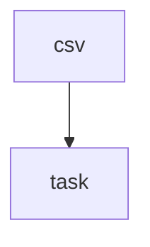

# 订单批量导出 — 总设计文档

> 设计时间: 2026-05-08
>
> 需求来源: 订单列表增加批量导出能力，支持筛选条件透传、后端异步生成 CSV

## 1. 背景与目标

**需求背景**: 订单列表已有筛选与分页，缺少批量导出能力。

**预期结果**: 用户提交导出请求，后端异步生成 CSV 并返回下载地址。

## 2. 范围 / 非范围

**In Scope**:

- 导出任务创建与查询接口
- 导出任务表与异步 worker
- 基于现有测试框架补充单元测试

**Out of Scope**:

- 不改造现有订单筛选逻辑
- 不支持 Excel，只支持 CSV

**运行环境与兼容约束**:

- Node.js 22.x、TypeScript；依赖版本由锁文件确定。
- 保持现有订单查询接口兼容；导出参数使用 task 模块定义的 `OrderFilters`。

## 3. 项目约定

### 3.1 代码规范

- **命名与风格**: 文件名 kebab-case，类名 PascalCase，函数和变量 camelCase；ESLint + Prettier，2 空格缩进、单引号、无分号。
- **错误处理**: controller 使用统一错误中间件，service 抛出业务异常。
- **日志**: `logger.info/error` 记录任务创建、状态变更和异常，包含 userId、taskId。
- **注释**: 公开函数使用 JSDoc，复杂逻辑补充必要注释。

### 3.2 测试约定

| 项目 | 约定 |
| --- | --- |
| 框架与配置 | 已安装的 Vitest，版本由锁文件确定；根级 `vitest.config.ts` 发现 `tests/*/unit/**/*.test.ts` 与 `tests/*/integration/**/*.integration.test.ts`，support 不作为独立用例执行 |
| 根目录与入口 | 根级 `test-runner.mjs` 以自身目录定位项目根，工作目录与 Vitest root 均使用该绝对路径 |
| 源码格式与命名 | TypeScript `.ts`；UT 为 `*.test.ts`，IT 为 `*.integration.test.ts`，通过 `test`/`it` 注册行为名；辅助源码为被测试实际调用的 `.ts` |
| 全量单元命令 | `node test-runner.mjs --kind unit --module all` |
| 全量集成命令 | `node test-runner.mjs --kind integration --module all` |
| 运行标识 | `test-runner.mjs` 每次调用生成唯一 UUID；module 取模块索引名称，case-id 由用例编号及参数实例标识构成，并行实例独立分配 |
| 临时数据 | `build/tests/runs/{run-id}/data/{module}/{case-id}/`；文件资源与临时辅助程序均在对应用例目录 |
| 原始产物 | 根级配置将 JSON/JUnit、日志及启用的覆盖率/缓存输出到 `build/tests/runs/{run-id}/artifacts/` |
| 清理与保留 | 用例 teardown 和运行入口退出处理回收本轮资源，失败、取消和超时后核对残留；交验所需原始证据保留至本次验收结束，故障诊断产物保留至问题定位结束，随后清理对应运行目录 |
| 数据依赖 | 仅构造最小合成场景，不依赖固定数据集；没有系统临时目录位置例外 |
| 版本控制 | 根 `.gitignore` 包含 `/build/`，build 无受跟踪文件 |
| 规范报告 | `tests/test-report.md` |

**测试入口契约**: `test-runner.mjs --kind <unit|integration> --module <all|task|csv>`。入口创建唯一运行目录，将 `TEST_PROJECT_ROOT`、`TEST_RUN_ID`、`TEST_KIND`、`TEST_MODULE` 传给以项目根为工作目录启动的 `npx --no-install vitest run`，并透传退出码。根配置与测试辅助源码读取同一组环境变量，不各自生成 run-id；根配置按类别和模块选择上述固定发现路径并设置产物输出。调用入口无需依赖启动目录，直接调用 Vitest 不构成本文约定的验证命令。

## 5. 模块索引与依赖关系

### 5.1 模块划分

| 模块 | 职责 | 文档 | 依赖模块 |
| --- | --- | --- | --- |
| task | 任务创建与查询接口、任务表设计与迁移 | [task](./task/index.md) | — |
| csv | 异步生成 CSV、更新任务状态 | [csv](./csv/index.md) | task |

### 5.2 模块依赖图

> csv 依赖 task 模块定义的 `ExportTask` 类型和任务表

### 5.3 循环依赖检查

> 结果: ✅ 无循环依赖

- 依赖图为单向：csv → task
- 拓扑序：先实施 task，再实施 csv

## 6. 风险与回滚

| 风险 | 概率 | 影响 | 缓解措施 |
| --- | --- | --- | --- |
| 导出任务积压 | 中 | 用户长时间等待 | 复用 job runner 并加监控 |
| 文件地址过期 | 低 | 下载失败 | 后端返回可刷新链接 |

**回滚方式**: 停用 worker；保留表结构不再写入新任务。

## 7. 跨模块未决问题

| # | 问题 | 影响范围 | 需要谁确认 |
| --- | --- | --- | --- |
| 1 | 导出文件保存时长 | 存储成本与下载策略 | 产品 / 运维 |
| 2 | 是否需要限制每人并发导出数 | 服务负载控制 | 后端负责人 |

导出文件保存时长和并发限制尚未确定，相关接口与容量验收受阻。
