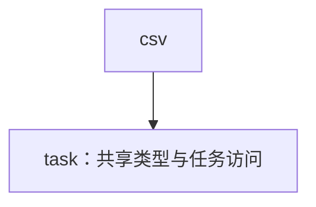

# 订单系统 — 总体设计

> 设计时间: 2026-05-08
>
> 需求依据: 订单筛选结果的异步 CSV 导出需求

## 1. 设计目标与范围

**项目定位**: 订单系统面向订单数据查询与结果交付。本设计定义与已有查询能力协作的异步导出方案。

**设计目标**: 调用方可提交筛选条件并取得导出任务，通过任务查询获取处理结果或失败原因；文件生成不阻塞创建请求，结果以 CSV 文件交付。

**覆盖范围**: 任务创建与查询、后台 CSV 生成、文件上传及结果关联。本文描述本设计涉及的模块和集成边界，不重建订单系统其他能力的内部方案。

**不在范围**: 既有订单筛选逻辑改造、Excel 导出和文件存储服务内部实现。

## 2. 总体方案

### 2.1 整体实现思路

采用持久化任务与后台处理。请求侧保存筛选条件并返回任务标识；后台按相同条件读取订单、生成 CSV 并上传文件；调用方通过任务查询取得状态与结果。共享任务记录连接请求侧和后台处理，避免在创建请求中等待文件完成。

### 2.2 主要处理链路

任务状态、筛选字段和具体接口在 [task](./task/index.md) 定义；后台处理及失败传播在 [csv](./csv/index.md) 定义。图中的结果返回表示运行时数据交接，不构成代码反向依赖。

### 2.3 关键设计选择

| 选择 | 采用方案 | 依据与影响 |
| --- | --- | --- |
| 导出执行方式 | 异步任务，复用 job runner | 文件生成与请求处理解耦，需要保存可查询的任务状态 |
| 大结果处理 | 流式生成 CSV | 控制文件生成时的内存占用，读取失败按模块契约传播 |
| 文件交付 | 复用文件存储 client | 避免重复实现存储能力，上传失败必须反映到任务结果 |

## 3. 代码架构

### 3.1 模块与代码组织

| 模块 | 职责摘要 | 模块归属与组织边界 | 详细设计 |
| --- | --- | --- | --- |
| task | 管理导出请求与可查询的任务记录 | 规划归属订单域 `server/modules/order/`；负责任务创建、查询、受控状态迁移及持久化，不执行文件生成 | [task](./task/index.md)；[功能索引](./task/index.md#function-index) |
| csv | 执行后台导出并记录结果 | 规划归属后台作业层 `server/jobs/`；承接执行器调度，依赖任务契约和文件存储能力 | [csv](./csv/index.md)；[处理契约](./csv/index.md#process-export) |

任务持久化与状态迁移规则归订单域管理；后台作业通过任务模块契约领取任务和写回结果，不直接访问任务存储。调度、订单查询和文件存储复用项目既有能力，具体行为与实现映射见归属模块的详细设计。

### 3.2 依赖与协作

task 通过既有 job runner 接口投递任务，不直接依赖 csv 实现；csv 使用 task 的共享类型和条件状态更新能力领取处理权、写回结果。订单查询能力与文件存储 client 是复用边界；[上传契约](./external-service/storage/upload.md#post-api-v2-upload) 由外部服务提供。

### 3.3 公共能力与契约归属

| 能力或共享契约 | 归属模块或层 | 使用方及约束 | 详细设计 |
| --- | --- | --- | --- |
| 筛选条件与任务类型 | task | csv 直接引用同一类型和状态定义，不维护副本 | [task 数据结构](./task/index.md#4-数据结构) |
| 任务创建、查询与状态更新契约 | task | 后台按条件迁移领取及写回；冲突、终态保护与存储错误由 task 契约定义 | [task 功能索引](./task/index.md#function-index) |
| 文件上传接口 | 文件存储服务；项目既有 client | csv 传递实际生成内容，错误按 csv 契约处理 | [上传接口](./external-service/storage/upload.md#post-api-v2-upload) |

### 3.4 依赖检查

业务代码依赖为 csv → task，无反向代码依赖，无环。实施顺序为 task 的共享定义和任务访问能力先就绪，再实现 csv；运行时请求与结果返回不改变该依赖结论。

## 4. 项目约束

| 约束项 | 必须满足的条件 | 来源或依据 | 影响范围及核验方式 |
| --- | --- | --- | --- |
| 技术栈 | Node.js 22.x、TypeScript，依赖版本遵循项目锁文件 | 项目运行约定 | 按项目工具链构建并执行测试 |
| 兼容范围 | 保持既有订单查询接口与筛选语义 | 订单导出需求边界 | task 参数测试及 csv 实际组合验证 |
| 交付格式 | 输出 CSV，不增加 Excel 支持 | 导出需求 | csv 内容及边界用例 |
| 状态一致性 | 上传或生成失败不得返回成功文件结果 | 任务查询与后台处理契约 | task/csv 错误路径及集成用例 |

## 5. 公共开发与验证约定

### 5.1 代码规范

| 规范项 | 项目约定或有效引用 | 适用范围与核验方式 |
| --- | --- | --- |
| 规范依据与检查 | 采用本节 TypeScript 编码约定；未提供可核验的格式化、静态或类型检查配置及命令，不宣称已配置或执行 | 全项目业务代码；人工逐项审查本表规则，§5.2 的业务测试不代替风格检查 |
| 命名与接口风格 | 文件名使用 `kebab-case`，类型名使用 `PascalCase`，函数和变量使用 `camelCase`；2 空格缩进、单引号、无分号；仅导出公开契约所需符号 | 公开接口与内部实现；人工核对命名、格式和导出边界 |
| 类型与数据约定 | 公共类型引用唯一维护定义；类型标注和断言不替代必要边界校验，不隐式引入未定义默认值；具体字段契约见 [task 数据结构](./task/index.md#4-数据结构) | 共享定义和输入边界；核对声明引用与接口校验，局部取值不在总表重复 |
| 错误处理 | 按接口契约自然传播错误，仅在承担语义转换、恢复或诊断责任的边界处理；不吞错、返回默认成功或逐层重复记录 | 项目公共调用边界；人工审查传播责任，具体行为及用例见 [task 功能索引](./task/index.md#function-index)、[csv 功能索引](./csv/index.md#function-index) |
| 资源与执行 | 取得资源的一方承担释放责任，不关闭借用的共享资源；覆盖实际适用退出路径，清理错误不隐式覆盖业务异常；具体生命周期与终态规则见 [csv 功能索引](./csv/index.md#function-index) | 实际持有资源的代码；沿所有权与调用链审查，并核对模块异常用例 |
| 配置与依赖使用 | 复用既有配置入口与依赖接口，不在业务模块重复建立配置、连接或日志系统；默认值仅来自已定义配置或契约 | 所有依赖使用方；核对初始化和调用位置，能力归属见 §3，共享参数未决项见 §6.2 |
| 日志 | 使用项目已有日志入口，按责任边界及模块事件契约记录，避免逐层重复；字段最小化，不记录凭据或未经允许的完整输入输出，无观测职责的纯计算逻辑不新增日志 | 有诊断职责的边界代码；核对 [task 事件](./task/index.md#request-diagnostics) 与 [csv 事件](./csv/index.md#process-export) 的责任、字段及对应测试 |
| 注释与接口说明 | 公开函数使用 JSDoc 说明输入、返回、异常和必要副作用；非显然逻辑解释约束与取舍，不为明显的私有逻辑机械补注释 | 公开接口与非显然实现；对照模块契约人工核对说明与代码，不以注释数量判断完整性 |

### 5.2 测试约定

| 项目 | 约定 |
| --- | --- |
| 框架与配置 | 已安装的 Vitest，版本由锁文件确定；根级 `vitest.config.ts` 发现 `tests/*/unit/**/*.test.ts` 与 `tests/*/integration/**/*.integration.test.ts`，support 不作为独立用例执行 |
| 根目录与入口 | 根级 `test-runner.mjs` 以自身目录定位项目根，工作目录与 Vitest root 均使用该绝对路径 |
| 源码格式与命名 | TypeScript `.ts`；UT 为 `*.test.ts`，IT 为 `*.integration.test.ts`，通过 `test`/`it` 注册行为名；辅助源码为被测试实际调用的 `.ts` |
| 全量单元命令 | `node "$PROJECT_ROOT/test-runner.mjs" --kind unit --module all` |
| 全量集成命令 | `node "$PROJECT_ROOT/test-runner.mjs" --kind integration --module all` |
| 用例编号 | 各模块使用自己的前缀（`task` 或 `csv`），UT 与 IT 在各自模块内分别按 §8 用例定义的出现顺序从 001 连续编号。模块迭代时可调整本模块编号，并同步本版设计和跨模块引用。developer 对齐测试，独立 validator 按新版本生成报告；既有报告按原版本解读 |
| 运行标识 | `test-runner.mjs` 每次调用生成唯一 UUID；module 取模块索引名称，case-id 由用例编号及参数实例标识构成，并行实例独立分配 |
| 临时数据 | `build/tests/runs/{run-id}/data/{module}/{case-id}/`；文件资源与临时辅助程序均在对应用例目录 |
| 原始产物 | 根级配置将 JSON/JUnit、日志及启用的覆盖率/缓存输出到 `build/tests/runs/{run-id}/artifacts/` |
| 清理与保留 | 用例 teardown 和运行入口退出处理回收本轮资源，失败、取消和超时后核对残留；交验所需原始证据保留至本次验收结束，故障诊断产物保留至问题定位结束，随后清理对应运行目录 |
| 数据依赖 | 仅构造最小合成场景，不依赖固定数据集；没有系统临时目录位置例外 |
| 版本控制 | 根 `.gitignore` 包含 `/build/`，build 无受跟踪文件 |
| 规范报告 | `tests/test-report.md` |

**测试入口契约**: 命令中的 `PROJECT_ROOT` 是调用方已定位的消费项目绝对路径。入口参数为 `test-runner.mjs --kind <unit|integration> --module <all|task|csv>`。入口创建唯一运行目录，将 `TEST_PROJECT_ROOT`、`TEST_RUN_ID`、`TEST_KIND`、`TEST_MODULE` 传给以项目根为工作目录启动的 `npx --no-install vitest run`，并透传退出码。根配置与测试辅助源码读取同一组环境变量，不各自生成 run-id；根配置按类别和模块选择上述固定发现路径并设置产物输出。调用入口无需依赖启动目录，直接调用 Vitest 不构成本文约定的验证命令。

## 6. 风险与待确认事项

### 6.1 风险与应对

| 风险 | 影响范围 | 应对措施与必要恢复条件 | 相关设计或验证 |
| --- | --- | --- | --- |
| 任务积压 | 导出等待时间与后台资源 | 复用 job runner；并发限制确认后补充容量验证 | §6.2，csv 实施与验收 |
| 结果文件失效 | 调用方无法读取导出结果 | 明确文件保留及访问期限；有效期策略尚未确认，不预设自动刷新能力 | §6.2，外部存储契约 |
| 导出功能回退 | 新任务创建和后台处理 | 停用导出入口及 worker，保留任务表以便核对已有记录 | task/csv 影响面与兼容性 |

### 6.2 跨模块未决问题

| 问题 | 影响范围 | 需要确认的事项 | 确认方 |
| --- | --- | --- | --- |
| 文件生命周期 | 结果交付和存储成本 | 保留时长、过期行为及访问策略 | 产品、运维 |
| 并发上限 | task 请求限制及 csv 容量 | 是否限制每人并发导出数及具体阈值 | 后端负责人 |

上述参数尚未明确，相关接口约束与容量验收存在阻塞；模块内部问题见对应模块 §11。task 的创建请求 `userId` 映射、创建与投递失败语义，以及 csv 的查询/格式/上传映射、runner 注册与查询/消费能力同样尚未明确；相关功能不能仅凭示例中的 API 签名或用例编号视为实施就绪。
