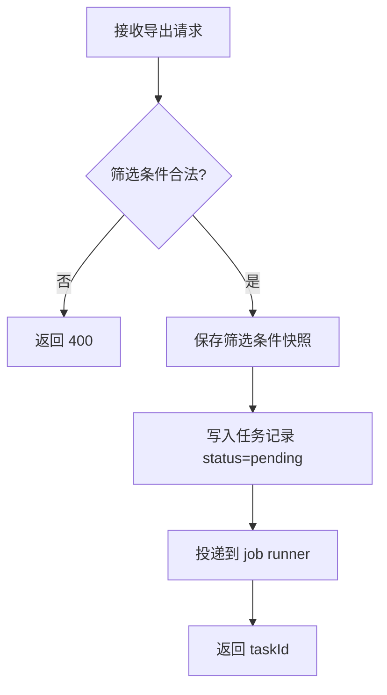
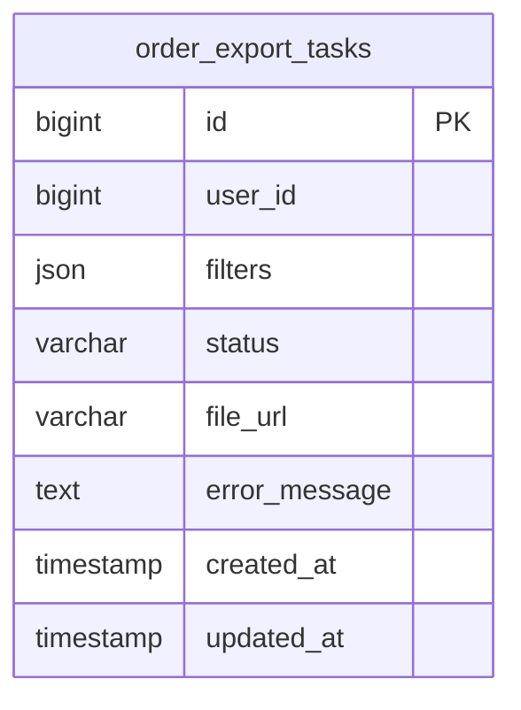

# 模块：task

> 设计时间: 2026-05-08
>
> 实施时间: —
>
> 所属设计: [订单系统](../index.md)
>
> 模块状态: ⏳ 待实现

## 1. 模块概述

**模块职责**: 管理导出任务的创建、查询及受控状态迁移，维护任务记录与持久化边界。

**业务边界**:

- 负责: 任务创建/查询 API、内部状态更新契约、任务表与迁移、参数校验
- 不负责: CSV 文件生成（由 csv 模块负责）

### 1.2 调用方约束

| 调用方 | 使用方式 | 调用或兼容约束 |
| --- | --- | --- |
| [csv](../csv/index.md) | 使用任务读取、状态更新契约及共享类型 | 通过 §3.2 的服务接口读写；不得直接访问任务 repository 或表；类型引用 §4 |

### 1.4 实现映射

| 实现位置 | 承担的职责与关键入口 | 依据或状态 |
| --- | --- | --- |
| `server/modules/order/order-export.controller.ts` | 请求与响应转换，使用项目统一错误边界；接口见 §3.1 | 规划 |
| `server/modules/order/order-export.service.ts` | 任务创建、查询和条件状态更新；公开模块契约见 §3.2 | 规划 |
| `server/modules/order/order-export.repository.ts` | 任务持久化及原子条件更新，仅由本模块服务调用；约束见 §3.2、§5 | 规划 |
| `server/db/migrations/` | 任务表迁移，数据库定义见 §5；具体迁移文件按项目命名规则生成 | 规划 |

## 2. 核心流程



## 3. API 定义

### 3.1 HTTP 接口

#### `POST /api/orders/export-tasks`

**描述**: 根据筛选条件创建导出任务。

**请求参数**:

| 参数 | 位置 | 类型 | 必填 | 说明 |
| --- | --- | --- | --- | --- |
| `filters` | body | object | 是 | 当前订单筛选条件 |

**返回**:

| 字段 | 类型 | 说明 |
| --- | --- | --- |
| `taskId` | `string` | 导出任务 ID |
| `status` | `string` | 固定为 `pending` |

**错误码**: 400 参数错误 / 500 内部错误

#### `GET /api/orders/export-tasks/:taskId`

**描述**: 查询单个导出任务状态与结果。

**返回**:

| 字段 | 类型 | 说明 |
| --- | --- | --- |
| `taskId` | `string` | 任务 ID |
| `status` | `string` | `pending` / `running` / `success` / `failed` |
| `fileUrl` | `string` | 成功时返回下载地址 |
| `errorMessage` | `string` | 失败时返回错误信息 |

**错误码**: 404 任务不存在 / 500 内部错误

### 3.2 函数/方法接口

#### `createExportTask(userId: string, filters: OrderFilters): Promise<ExportTask>`

| 参数 | 类型 | 必填 | 说明 |
| --- | --- | --- | --- |
| `userId` | `string` | 是 | 发起人 |
| `filters` | OrderFilters | 是 | 筛选条件 |

**返回**: `Promise<ExportTask>` — 新建的导出任务

**错误**: `filters` 不符合 §4 契约时抛出参数错误；依赖调用失败时传播原错误，不返回成功任务。HTTP 状态转换由 §3.1 的统一请求边界处理。

#### `getExportTask(taskId: string): Promise<ExportTask>`

| 参数 | 类型 | 必填 | 说明 |
| --- | --- | --- | --- |
| `taskId` | `string` | 是 | 任务 ID |

**返回**: `Promise<ExportTask>` — 任务记录

**错误**: repository 返回空结果时由 service 转换为任务不存在的业务错误；依赖失败时传播原错误。HTTP 边界按 §3.1 转换为对应状态，不在 repository 重复记录失败。

#### `transitionExportTask(taskId: string, change: ExportTaskChange): Promise<ExportTask | null>`

供后台作业使用的模块内部服务接口，不增加 HTTP 路由。`taskId` 为非空任务标识，沿用任务查询的标识语义；`change` 为 §4 的判别联合，不接受未知字段。

| 当前状态 | `change` | 原子写入 | 返回 |
| --- | --- | --- | --- |
| `pending` | `{status: 'running'}` | 状态变为 `running`，清空两个结果字段，刷新 `updatedAt` | 更新后的任务 |
| `running` | `{status: 'success', fileUrl}` | 状态和 `fileUrl` 一并写入，清空 `errorMessage`，刷新 `updatedAt` | 更新后的任务 |
| `running` | `{status: 'failed', errorMessage}` | 状态和 `errorMessage` 一并写入，清空 `fileUrl`，刷新 `updatedAt` | 更新后的任务 |
| 其他已有状态 | 合法的上述请求 | 不写入，包括同状态重复调用和任何终态覆盖 | `null` |

返回 `null` 表示本次未取得处理权或未完成要求的迁移，不能作为本次写入成功。不存在的任务抛出与 `getExportTask` 相同的任务不存在错误。成功结果必须对应本次条件更新；`taskId`、`userId`、`filters`、`createdAt` 始终不变。`success`、`failed` 是终态，没有重置、重新领取或改写结果的接口。

先验证参数再访问存储：`taskId` 必须是非空字符串，`change` 必须是非空对象且不是数组；`running` 不携带结果字段；`success` 只带非空字符串 `fileUrl`，满足 §5 的列容量；`failed` 只带非空字符串 `errorMessage`。不兼容的状态标签、未知字段、结果字段混用及非法值均抛参数错误，不访问 repository。错误摘要由调用方按业务阶段提供受控信息，不能把凭据、订单内容或原始异常文本作为结果写入。

repository 必须以任务标识及预期源状态完成原子条件更新，状态、结果字段和时间一次提交，不能“先查询状态，再无条件更新”。只有一个调用能把同一 `pending` 任务变为 `running`；未命中时区分任务不存在和状态不匹配，并按上述契约返回。条件更新及结果读取沿用项目数据库的事务能力，不能在返回对象中伪造未提交状态。

数据库错误原样传播，不返回成功任务或 `null` 冒充失败。已确认未提交的错误不得留下部分修改；连接中断等错误若无法确认提交结果，不假定事务已经回滚，调用方只能将结果视为未知并通过查询核对，不能据异常自动重试导出或写另一个终态。本接口不重复记录 worker 的处理事件。

### 3.3 日志与诊断

使用项目已有 logger。任务创建成功由 service 记录，公共请求失败由 controller 的统一错误边界记录；service 和 repository 不逐层重复记录同一失败。上下文只包含已允许且实际可取得的 `userId`、`taskId` 和安全错误码，不记录凭据、完整筛选条件、订单内容或未经允许的原始异常文本。服务错误按 §3.2 契约传播，测试核对事件责任与次数。

## 4. 数据结构

### OrderFilters

订单筛选契约由本模块定义，csv 模块引用该定义。空对象表示不增加筛选条件；不接受未知字段，已提供字段不得为 null。

```typescript
interface OrderFilters {
  keyword?: string
  status?: 'pending' | 'paid' | 'cancelled'
}
```

`keyword` 为 1–100 个字符，匹配订单编号或标题；省略表示不按关键词筛选。`status` 使用订单状态，与导出任务的处理状态不同。时间范围筛选尚未纳入该契约，是否增加由 §11 的未决问题确认后更新。

### ExportTask

```typescript
interface ExportTask {
  taskId: string
  userId: string
  filters: OrderFilters
  status: 'pending' | 'running' | 'success' | 'failed'
  fileUrl?: string
  errorMessage?: string
  createdAt: string
  updatedAt: string
}
```

repository 将数据库 BIGINT 标识转为十进制字符串，避免 JavaScript `number` 精度损失；时间字段转为 ISO 8601 字符串。

### ExportTaskChange

```typescript
type ExportTaskChange =
  | { status: 'running' }
  | { status: 'success'; fileUrl: string }
  | { status: 'failed'; errorMessage: string }
```

合法任务在 `pending`、`running` 时不暴露结果字段；`success` 仅带 `fileUrl`，`failed` 仅带 `errorMessage`。数据库 `NULL` 映射为 API 中缺省字段。类型声明不代替 §3.2 的运行时校验。

## 5. 数据库设计

### ER 图



本次只新增导出任务表，不改变现有用户或订单表；`user_id` 记录发起人标识，不在本次迁移中新增跨表外键。

### 表结构定义

#### `order_export_tasks`

| 字段 | 类型 | 约束 | 说明 |
| --- | --- | --- | --- |
| id | BIGINT | PK, AUTO_INCREMENT | 主键 |
| user_id | BIGINT | NOT NULL | 发起用户 |
| `filters` | JSON | NOT NULL | 筛选条件快照 |
| `status` | VARCHAR(20) | NOT NULL, DEFAULT '`pending`' | 任务状态 |
| file_url | VARCHAR(1024) | NULL | 导出文件地址 |
| error_message | TEXT | NULL | 失败原因 |
| created_at | TIMESTAMP | NOT NULL | 创建时间 |
| updated_at | TIMESTAMP | NOT NULL | 更新时间 |

### 索引设计

| 表 | 索引名 | 字段 | 类型 | 用途 |
| --- | --- | --- | --- | --- |
| order_export_tasks | idx_user_created_at | user_id, created_at | BTREE | 用户最近任务查询 |
| order_export_tasks | idx_status | `status` | BTREE | worker 扫描待处理 |

### 结构与数据变更

新增 `order_export_tasks` 表，使用项目现有迁移机制创建；无存量数据需要转换。

## 7. 影响面与兼容性

- **本模块影响**: `server/modules/order/` 新增导出相关文件
- **对依赖模块的影响**: 为 csv 提供共享类型、读取及条件状态更新服务；表与 repository 留在 task 内部
- **兼容性处理**: 原有订单列表接口不变
- **迁移/发布注意事项**: 先发布表结构与 API，再部署 csv 模块

## 8. 测试设计

### 8.1 测试策略

**公共约定**: [项目测试约定](../index.md#52-测试约定)。

- **模块单元命令**: `node test-runner.mjs --kind unit --module task`。
- **真实调用与替身边界**: service 用受控 repository、job runner；repository 替换数据库客户端；controller 替换 service。各层使用自身真实实现，验证参数、返回和错误传播。
- **前置条件**: 测试前确认被测接口可调用，依赖替身返回值与错误符合对应用例。

### 8.2 测试用例

#### `createExportTask` 测试

| 用例编号 | 用例 | 输入 | 预期输出 | 类型 | 状态 |
| --- | --- | --- | --- | --- | --- |
| `task-UT-001` | 正常路径 - 创建成功 | `filters={status: 'paid'}` | 返回 `pending` 任务；创建成功事件一次且仅含约定字段 | happy path | ⏳ 待实现 |
| `task-UT-002` | 边界 - 空筛选条件 | `{}`，repository 与 runner 为受控替身 | 创建并返回 `pending` 任务，持久化的 `filters` 保持 `{}`，不补默认条件；按 runner 契约投递该 `taskId` 一次，不执行或断言 CSV 生成 | boundary | ⏳ 待实现 |
| `task-UT-003` | 异常 - 无效 `filters` | `{invalid: true}` | 抛出参数错误 | error | ⏳ 待实现 |

#### `getExportTask` 测试

| 用例编号 | 用例 | 输入 | 预期输出 | 类型 | 状态 |
| --- | --- | --- | --- | --- | --- |
| `task-UT-004` | 正常路径 - 查询成功 | 存在的 `taskId` | 返回任务记录 | happy path | ⏳ 待实现 |
| `task-UT-005` | 异常 - 任务不存在 | 不存在的 `taskId` | 抛出 not found | error | ⏳ 待实现 |

#### repository 与 controller 测试

| 用例编号 | 用例 | 输入 | 预期输出 | 类型 | 状态 |
| --- | --- | --- | --- | --- | --- |
| `task-UT-006` | repository 保存并查询 | mock 数据库返回 id=1 的 `pending` 记录 | 保存参数含 `filters`，查询返回对应 ExportTask | happy path | ⏳ 待实现 |
| `task-UT-007` | repository 查询不存在记录 | mock 数据库返回空结果 | 返回空结果，由 service 转换为 not found | boundary | ⏳ 待实现 |
| `task-UT-008` | repository 数据库失败 | mock 数据库抛出连接错误 | 向调用方传播原错误，不返回成功任务或在 repository 重复记录失败 | error | ⏳ 待实现 |
| `task-UT-009` | controller 创建成功 | `filters={status: 'paid'}`，mock service 返回 `taskId`='1' | 响应包含 `taskId`='1'、`status`=`pending` | happy path | ⏳ 待实现 |
| `task-UT-010` | controller 非法参数 | `filters` 缺失或类型错误 | 返回 400，不调用 service；由统一错误边界记录一次失败，不记录原始 `filters` | error | ⏳ 待实现 |
| `task-UT-011` | controller 查询不存在任务 | mock service 抛出 not found | 返回 404 | error | ⏳ 待实现 |

#### `transitionExportTask` 与条件更新测试

service 用受控 repository 验证业务校验、状态映射和返回；repository 使用数据库驱动替身验证真实持久化实现传入的条件与字段。驱动替身只实现通用数据读写、条件匹配和提交故障，不复制 service 的迁移规则。不以替身结果宣称已验证实际数据库的隔离实现。

| 用例编号 | 用例 | 输入与前置条件 | 预期输出 | 类型 | 状态 |
| --- | --- | --- | --- | --- | --- |
| `task-UT-012` | 三种合法迁移 | 独立实例分别为 `pending`→`running`、`running`→`success` 和 `running`→`failed`，结果字段合法 | 返回已提交快照；源状态条件、目标状态、结果字段清空/写入及时间正确；身份、筛选快照和创建时间不变 | happy path | ⏳ 待实现 |
| `task-UT-013` | 不匹配与终态保护 | 对四种当前状态分别提交三种合法请求，排除 UT-012 的三组 | 剩余九组均返回 `null`，状态、结果字段及时间完全不变；同状态请求不当作成功重放 | boundary | ⏳ 待实现 |
| `task-UT-014` | 更新参数校验 | 空或非字符串任务标识、`change` 为 `null`/数组/非对象、非法状态标签、未知字段、混用结果字段、空/非字符串结果值，及超出列容量的 `fileUrl` | 各实例均抛参数错误；repository 未调用 | error | ⏳ 待实现 |
| `task-UT-015` | 任务不存在 | 合法请求，repository 报不存在 | 抛任务不存在错误，不返回 `null` 或伪造任务 | error | ⏳ 待实现 |
| `task-UT-016` | 存储失败 | 分别模拟确认未提交、提交结果未知的指定存储异常 | 原异常对象传播，不返回成功或 `null`；未提交场景记录不变，未知场景不宣称回滚或自动重试 | error | ⏳ 待实现 |
| `task-UT-017` | 领取竞争与条件写入 | 真实 repository 面对同一 `pending` 记录两次领取；第二次写入前驱动替身呈现首个调用已提交的 `running` | 首次返回任务，第二次不命中；两次均带预期源状态条件，不能覆盖首个结果。用受控副本移除条件后，本断言须失败 | boundary | ⏳ 待实现 |

### 8.3 测试文件与数据

| 测试文件 | 覆盖目标 |
| --- | --- |
| `tests/task/unit/order-export.service.test.ts` | 任务创建、查询与状态迁移业务契约 |
| `tests/task/unit/order-export.controller.test.ts` | 请求校验与响应 |
| `tests/task/unit/order-export.repository.test.ts` | 数据库调用、记录映射与条件更新 |
| `tests/task/support/scenario.ts` | 最小场景构造，由上述单元测试调用 |

**数据准备**: `tests/task/support/scenario.ts` 为上述测试构造最小场景。本模块用例只使用内存数据。

> 与 csv 的跨模块协作验证由调用方 [csv §8.4](../csv/index.md#84-项目内集成验证) 定义，本模块不重复定义同一集成用例。

## 9. 实施计划

| 步骤 | 可测试单元 | 涉及文件 | 对应设计 | 用例编号 | 依赖 | 状态 |
| --- | --- | --- | --- | --- | --- | --- |
| 1 | 配置测试入口，定义类型、迁移与 repository，验证记录映射、错误和原子条件写入；迁移另在测试库验证 | `test-runner.mjs`、`vitest.config.ts`、`server/db/migrations/*`、`server/modules/order/order-export.repository.ts` 及对应测试 | 总文档 §5.2、本模块 §3、§4、§5、§8 | `task-UT-006` 至 `008`、`017` | — | ⏳ 待实现 |
| 2 | 实现创建、查询及状态迁移服务，立即编写并运行本层测试，不依赖 csv 导出结果 | `server/modules/order/order-export.service.ts` 及对应测试 | §3、§8 | `task-UT-001` 至 `005`、`012` 至 `016` | 步骤 1 | ⏳ 待实现 |
| 3 | 实现 controller，立即编写并运行请求及响应测试 | `server/modules/order/order-export.controller.ts` 及对应测试 | §3、§8 | `task-UT-009` 至 `011` | 步骤 2 | ⏳ 待实现 |
| 4 | 运行全量回归并按验收标准核验 | §8.3 全部测试文件 | §8、§10 | `task-UT-001` 至 `017` | 步骤 3 | ⏳ 待实现 |

## 10. 验收标准

| # | 对应需求 | 设计位置 | 验收项 | 用例编号或核验方法 | 状态 |
| --- | --- | --- | --- | --- | --- |
| 1 | 创建导出任务、保存筛选快照 | §3.1 创建接口、§4、§5 | 返回 `pending` 任务，正确持久化快照 | `task-UT-001`、`002`、`006`、`008`、`009` | ⏳ 待实现 |
| 2 | 查询任务状态与结果 | §3.1 查询接口、§3.2 | 返回对应任务，不存在时返回 404 | `task-UT-004`、`005`、`007`、`011` | ⏳ 待实现 |
| 3 | 筛选条件校验 | §3、§4 OrderFilters | 非法参数返回 400，不创建任务 | `task-UT-003`、`010` | ⏳ 待实现 |
| 4 | 本模块测试要求 | §8 | 本模块全部单元用例通过 | `task-UT-001` 至 `017`，执行 §8.1 命令 | ⏳ 待实现 |
| 5 | 受控状态及结果更新 | §3.2、§4 | 三种合法迁移原子写入，非法载荷拒绝，终态不覆盖，存储异常不冒充成功 | `task-UT-012` 至 `017`；真实协作见 csv §8.4 | ⏳ 待实现 |
| 6 | 空筛选条件在创建边界内完整传递 | §3.2、§4 | 保留空快照并投递任务，不以 task 单元结果宣称导出完成 | `task-UT-002` | ⏳ 待实现 |

“空条件导出全部数据”的完整结果由 [csv §8.4](../csv/index.md#84-项目内集成验证) 的 `csv-IT-003` 验证；该结果不作为 task 单元阶段的预期，也不替代本模块的创建边界验收。

## 11. 未决问题

| # | 问题 | 影响范围 | 需要谁确认 |
| --- | --- | --- | --- |
| 1 | 筛选条件快照的 JSON 字段容量上限 | 表结构设计 | 后端负责人 |
| 2 | 是否需要支持按时间范围批量导出 | API 参数设计 | 产品 |

筛选快照容量和时间范围筛选规则尚未确定，相关表结构与参数验收受阻。
