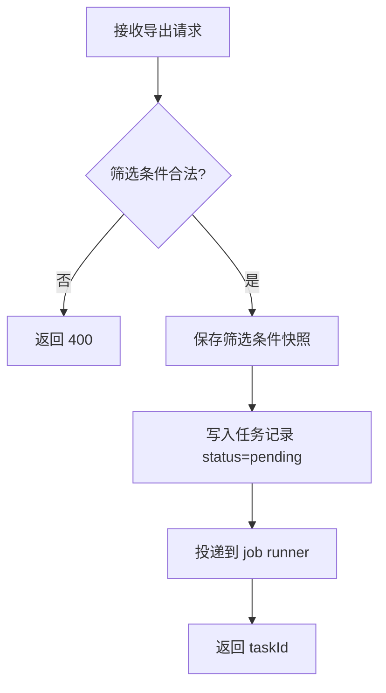
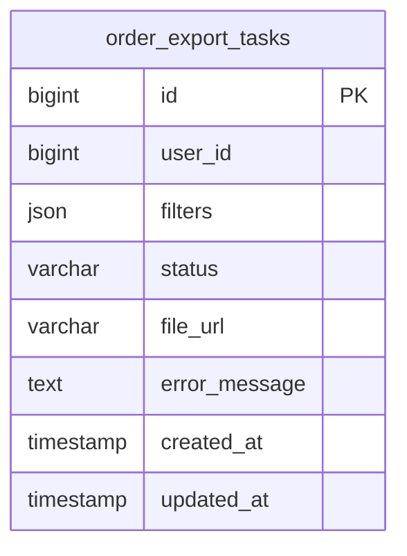

# 模块：task

> 设计时间: 2026-05-08
>
> 实施时间: —
>
> 所属设计: [订单系统](../index.md)
>
> 模块状态: ⏳ 待实现

## 1. 模块概述

**模块职责**: 管理导出任务的创建、查询及受控状态迁移，维护任务记录与持久化边界。

**业务边界**:

- 负责: 任务创建/查询 API、内部状态更新契约、任务表与迁移、参数校验
- 不负责: CSV 文件生成（由 csv 模块负责）

### 1.2 调用方约束

| 调用方 | 使用方式 | 调用或兼容约束 |
| --- | --- | --- |
| [csv](../csv/index.md) | 使用任务读取、状态更新契约及共享类型 | 通过“3.2 查询导出任务”、“3.3 领取待处理的导出任务”、“3.4 提交导出任务的处理结果”的功能接口及“2.2 领取与提交结果的共用更新契约”读写；不得直接访问任务 repository 或表；类型引用“4. 数据结构” |

### 1.4 实现映射

| 实现位置 | 承担的职责与关键入口 | 依据或状态 |
| --- | --- | --- |
| `server/modules/order/order-export.controller.ts` | 请求与响应转换，使用项目统一错误边界；接口见“3.1 创建导出任务”、“3.2 查询导出任务” | 规划 |
| `server/modules/order/order-export.service.ts` | 任务创建、查询和条件状态更新；公开模块契约见“3. 功能行为与接口”，状态更新共用契约见“2.2 领取与提交结果的共用更新契约” | 规划 |
| `server/modules/order/order-export.repository.ts` | 任务持久化及原子条件更新，仅由本模块服务调用；约束见“2.2 领取与提交结果的共用更新契约”、“5. 数据库设计” | 规划 |
| `server/db/migrations/` | 任务表迁移，数据库定义见“5. 数据库设计”；具体迁移文件按项目命名规则生成 | 规划 |

## 2. 内部设计与共享规则

### 2.1 内部职责与状态归属

controller 承担创建、查询的请求与响应转换；service 拥有任务业务行为；repository 仅负责持久化、记录映射与条件更新。任务记录、筛选快照、结果及时间字段归本模块维护，csv 只能通过功能接口读取或请求迁移。具体私有实现按这些责任组织，不要求额外固定辅助函数。

<a id="transition-contract"></a>

### 2.2 领取与提交结果的共用更新契约

<a id="api-transition-export-task"></a>

#### `transitionExportTask(taskId: string, change: ExportTaskChange): Promise<ExportTask | null>`

**简介**: 后台作业通过同一服务接口[领取任务](#claim-task)或[提交处理结果](#submit-result)，各功能定义允许的载荷、源状态及结果字段规则。

**参数**:

| 参数 | 类型 | 必填 | 说明 |
| --- | --- | --- | --- |
| `taskId` | `string` | 是 | 非空任务标识，与任务查询使用同一标识 |
| `change` | `ExportTaskChange` | 是 | “4. 数据结构”定义的判别联合，不接受未知字段 |

**返回**: `Promise<ExportTask | null>`。条件更新已提交时返回更新后的任务，任务存在但源状态不匹配时返回 `null`，表示本次未取得处理权或未完成迁移。

**错误**: 服务在访问 repository 前校验参数。`taskId` 必须是非空字符串，`change` 必须是非空对象且不是数组。违反这些约束、状态标签不兼容、字段未知、结果字段混用或取值非法时抛出参数错误。任务不存在时抛出与 `getExportTask` 相同的业务错误。数据库错误原样传播。

`taskId`、`userId`、`filters`、`createdAt` 始终不变。`success`、`failed` 是终态，没有重置、重新领取或改写结果的接口。该服务接口不增加 HTTP 路由。

repository 必须以任务标识及预期源状态完成原子条件更新，状态、结果字段和时间一次提交，不能“先查询状态，再无条件更新”。未命中时区分任务不存在和状态不匹配，并按上述契约返回。条件更新及结果读取沿用项目数据库的事务能力，不能在返回对象中伪造未提交状态。

已确认未提交的错误不得留下部分修改；连接中断等错误若无法确认提交结果，不假定事务已经回滚，调用方只能将结果视为未知并通过查询核对，不能据异常自动重试导出或写另一个终态。本接口不重复记录 worker 的处理事件。

#### 共用协议验证

[状态更新用例](#tests-transition)统一标明更新协议、领取与提交的适用状态和参数实例。

<a id="request-diagnostics"></a>

### 2.3 请求日志与诊断

创建和查询使用项目已有 logger，公共请求失败由 controller 的统一错误边界记录；service 和 repository 不逐层重复记录同一失败。上下文只包含已允许且实际可取得的 `userId`、`taskId` 和安全错误码，不记录凭据、完整筛选条件、订单内容或未经允许的原始异常文本。服务错误按各功能及“2.2 领取与提交结果的共用更新契约”的共用契约传播，测试核对事件责任与次数。创建成功事件归属见创建功能。

<a id="functional-behavior"></a>

## 3. 功能行为与接口

<a id="function-index"></a>

### 功能索引

| 功能 | API 定义 |
| --- | --- |
| [创建导出任务](#create-task) | [`POST /api/orders/export-tasks`](#api-post-export-tasks)、[`createExportTask`](#api-create-export-task) |
| [查询导出任务](#query-task) | [`GET /api/orders/export-tasks/:taskId`](#api-get-export-task-route)、[`getExportTask`](#api-get-export-task) |
| [领取导出任务](#claim-task) | [`transitionExportTask`](#api-transition-export-task) 的 `running` 分支 |
| [提交处理结果](#submit-result) | [`transitionExportTask`](#api-transition-export-task) 的 `success` / `failed` 分支 |

<a id="create-task"></a>

### 3.1 创建导出任务

**目的与触发**: 调用方提交订单筛选条件，创建可查询的异步任务；HTTP 接口和服务方法共同实现此功能。

**前置与输入**: `filters` 遵循“4. 数据结构”`OrderFilters`；服务需要发起人的 `userId`。HTTP 请求到 `userId` 的映射及创建与投递的一致性仍见“11. 未决问题”，相关端到端路径尚未就绪。

<a id="api-post-export-tasks"></a>

#### `POST /api/orders/export-tasks`

**描述**: 根据筛选条件创建导出任务。

**请求参数**:

| 参数 | 位置 | 类型 | 必填 | 说明 |
| --- | --- | --- | --- | --- |
| `filters` | body | object | 是 | 当前订单筛选条件 |

**返回**:

| 字段 | 类型 | 说明 |
| --- | --- | --- |
| `taskId` | `string` | 导出任务 ID |
| `status` | `string` | 固定为 `pending` |

**错误码**: 400 参数错误 / 500 内部错误

<a id="api-create-export-task"></a>

#### `createExportTask(userId: string, filters: OrderFilters): Promise<ExportTask>`

**简介**: 为发起人创建导出任务，并将任务标识投递给后台执行器。

**参数**:

| 参数 | 类型 | 必填 | 说明 |
| --- | --- | --- | --- |
| `userId` | `string` | 是 | 发起人 |
| `filters` | `OrderFilters` | 是 | 筛选条件 |

**返回**: `Promise<ExportTask>` — 新建的导出任务

**错误**: `filters` 不符合“4. 数据结构”契约时抛出参数错误；依赖调用失败时传播原错误，不返回成功任务。HTTP 状态转换由本功能的统一请求边界处理。

**处理规则**: 校验筛选条件，保存快照，持久化 `pending` 任务后向既有 job runner 投递该 `taskId` 一次；空条件保持 `{}`，不补默认条件，不同步生成 CSV。



**结果与副作用**: 返回新建任务或 HTTP 中的 `taskId`、`pending`；创建成功由 service 记录一次成功事件，字段限制见“2.3 请求日志与诊断”。

**失败后状态**: 参数非法时不创建任务；依赖失败传播原错误，不返回成功任务。持久化后投递失败时记录及补偿语义未明确，必须按“11. 未决问题”确认，不能宣称自动回滚、重试或最终必达。

#### 验证关联

- `createExportTask`：[创建服务用例](#tests-create) `task-UT-001` 验证任务状态和创建事件，`002` 验证空筛选快照及投递，`003` 验证非法筛选条件的参数错误。
- `POST /api/orders/export-tasks`：[HTTP 适配用例](#tests-adapters) `task-UT-009` 验证响应的任务标识和状态，`010` 验证非法请求返回 400 且不调用服务。成功响应使用服务替身，不证明实际投递。
- 持久化边界：[存储用例](#tests-adapters) `task-UT-006` 仅取保存参数含 `filters` 的断言；同一用例的查询断言归查询功能。[跨模块用例](../csv/index.md#84-项目内集成验证) `csv-IT-003` 仅取“创建时不生成文件”的断言；其他场景中的创建只作准备。

<a id="query-task"></a>

### 3.2 查询导出任务

**目的与触发**: 调用方按任务标识查询当前状态、下载地址或失败信息；HTTP 接口和服务方法共同实现此功能。

**前置与输入**: 输入 `taskId`，读取对应任务记录。

<a id="api-get-export-task-route"></a>

#### `GET /api/orders/export-tasks/:taskId`

**描述**: 查询单个导出任务状态与结果。

**返回**:

| 字段 | 类型 | 说明 |
| --- | --- | --- |
| `taskId` | `string` | 任务 ID |
| `status` | `string` | `pending` / `running` / `success` / `failed` |
| `fileUrl` | `string` | 成功时返回下载地址 |
| `errorMessage` | `string` | 失败时返回错误信息 |

**错误码**: 404 任务不存在 / 500 内部错误

<a id="api-get-export-task"></a>

#### `getExportTask(taskId: string): Promise<ExportTask>`

**简介**: 按任务标识读取当前状态和已保存的结果字段。

**参数**:

| 参数 | 类型 | 必填 | 说明 |
| --- | --- | --- | --- |
| `taskId` | `string` | 是 | 任务 ID |

**返回**: `Promise<ExportTask>` — 任务记录

**错误**: repository 返回空结果时由 service 转换为任务不存在的业务错误；依赖失败时传播原错误。HTTP 边界按本功能的 HTTP 契约转换为对应状态，不在 repository 重复记录失败。

**处理规则**: 读取任务记录，按“4. 数据结构”映射标识、时间与可见结果字段，不修改任务。

**结果与副作用**: 返回当前 `ExportTask` 或上述 HTTP 响应，不触发导出或状态迁移。

**失败后状态**: 未找到记录转换为任务不存在错误，存储失败原样传播；查询不写状态，也不以默认成功结果代替错误。

#### 验证关联

[查询服务用例](#tests-query) `task-UT-004`、`005`；[存储与 HTTP 适配用例](#tests-adapters) `task-UT-006` 的记录返回断言及 `007`、`011`。[csv 集成用例](../csv/index.md#84-项目内集成验证)使用查询观察处理与写回结果，不计为查询功能验证。

<a id="claim-task"></a>

### 3.3 领取待处理的导出任务

**目的与触发**: 后台处理开始时竞争同一任务的唯一处理权。

**前置与输入**: 通过 [共用接口](#transition-contract) 提交 `{status: 'running'}`，不得携带结果字段；沿用“2.2 领取与提交结果的共用更新契约”的通用校验和异常契约。

**处理规则与结果**:

| 当前状态 | 原子写入 | 返回及副作用 |
| --- | --- | --- |
| `pending` | 状态变为 `running`，清空两个结果字段，刷新 `updatedAt` | 返回更新后的任务快照；只有一个调用能领取成功 |
| `running` / `success` / `failed` | 不写入，所有字段及时间不变 | 返回 `null`，同状态重复领取不视为成功重放 |

**失败后状态**: 参数错误不访问 repository；任务不存在、存储失败以及未提交与未知结果的区别均遵循“2.2 领取与提交结果的共用更新契约”。领取失败不授予处理权，调用方不得据此生成或上传。

#### 验证关联

[状态更新用例](#tests-transition) `task-UT-012`、`013` 中目标为 `running` 的实例及 `017`，验证领取成功、三种拒绝及原子竞争；`014` 仅引用可归属 `running` 分支的非法载荷实例。共用参数与错误协议的适用范围见该组说明，不据未指定请求分支的实例宣称领取覆盖；跨模块领取竞争由 [csv 8.4 项目内集成验证](../csv/index.md#84-项目内集成验证)的 `csv-IT-004` 验证。

<a id="submit-result"></a>

### 3.4 提交导出任务的处理结果

**目的与触发**: 后台生成或上传结束后，将业务结果与任务终态一起提交。

**前置与输入**: 通过 [共用接口](#transition-contract) 提交 `success` 或 `failed` 分支。`success` 只带非空字符串 `fileUrl`，满足“5. 数据库设计”的列容量；`failed` 只带非空字符串 `errorMessage`。错误摘要由调用方按业务阶段提供受控信息，不能把凭据、订单内容或原始异常文本作为结果写入；通用校验见“2.2 领取与提交结果的共用更新契约”。

**处理规则与结果**:

| 当前状态 | `change` | 原子写入 | 返回 |
| --- | --- | --- | --- |
| `running` | `{status: 'success', fileUrl}` | 状态和 `fileUrl` 一并写入，清空 `errorMessage`，刷新 `updatedAt` | 更新后的任务 |
| `running` | `{status: 'failed', errorMessage}` | 状态和 `errorMessage` 一并写入，清空 `fileUrl`，刷新 `updatedAt` | 更新后的任务 |
| `pending` / `success` / `failed` | 合法的上述请求 | 不写入，所有字段及时间不变；包括同状态重复调用和任何终态覆盖 | `null` |

**失败后状态**: 错误与提交可确认性遵循“2.2 领取与提交结果的共用更新契约”；冲突不得冒充成功，不能依据未知提交结果写另一个终态。与领取功能合计只有三种合法迁移，四种状态分别提交三种合法请求时其余九组拒绝且无修改。

#### 验证关联

[状态更新用例](#tests-transition) `task-UT-012`、`013` 中目标为 `success` / `failed` 的实例，验证两个终态分支和六种拒绝；`014` 仅引用可归属这两个分支的非法载荷实例。共用参数与错误协议的适用范围见该组说明，不据未指定请求分支的实例宣称提交覆盖；[csv 8.4 项目内集成验证](../csv/index.md#84-项目内集成验证)的 `csv-IT-001`、`002` 验证成功与失败结果写回，`005` 验证提交未知。

## 4. 数据结构

### OrderFilters

订单筛选契约由本模块定义，csv 模块引用该定义。空对象表示不增加筛选条件；不接受未知字段，已提供字段不得为 null。

```typescript
interface OrderFilters {
  keyword?: string
  status?: 'pending' | 'paid' | 'cancelled'
}
```

`keyword` 为 1–100 个字符，匹配订单编号或标题；省略表示不按关键词筛选。`status` 使用订单状态，与导出任务的处理状态不同。时间范围筛选尚未纳入该契约，是否增加取决于“11. 未决问题”中列出的时间范围决策。

### ExportTask

```typescript
interface ExportTask {
  taskId: string
  userId: string
  filters: OrderFilters
  status: 'pending' | 'running' | 'success' | 'failed'
  fileUrl?: string
  errorMessage?: string
  createdAt: string
  updatedAt: string
}
```

repository 将数据库 BIGINT 标识转为十进制字符串，避免 JavaScript `number` 精度损失；时间字段转为 ISO 8601 字符串。

### ExportTaskChange

```typescript
type ExportTaskChange =
  | { status: 'running' }
  | { status: 'success'; fileUrl: string }
  | { status: 'failed'; errorMessage: string }
```

合法任务在 `pending`、`running` 时不暴露结果字段；`success` 仅带 `fileUrl`，`failed` 仅带 `errorMessage`。数据库 `NULL` 映射为 API 中缺省字段。类型声明不代替“2.2 领取与提交结果的共用更新契约”、“3.3 领取待处理的导出任务”、“3.4 提交导出任务的处理结果”的运行时校验。

## 5. 数据库设计

### ER 图



本次只新增导出任务表，不改变现有用户或订单表；`user_id` 记录发起人标识，不在本次迁移中新增跨表外键。

### 表结构定义

#### `order_export_tasks`

| 字段 | 类型 | 约束 | 说明 |
| --- | --- | --- | --- |
| id | BIGINT | PK, AUTO_INCREMENT | 主键 |
| user_id | BIGINT | NOT NULL | 发起用户 |
| `filters` | JSON | NOT NULL | 筛选条件快照 |
| `status` | VARCHAR(20) | NOT NULL, DEFAULT '`pending`' | 任务状态 |
| file_url | VARCHAR(1024) | NULL | 导出文件地址 |
| error_message | TEXT | NULL | 失败原因 |
| created_at | TIMESTAMP | NOT NULL | 创建时间 |
| updated_at | TIMESTAMP | NOT NULL | 更新时间 |

### 索引设计

| 表 | 索引名 | 字段 | 类型 | 用途 |
| --- | --- | --- | --- | --- |
| order_export_tasks | PRIMARY | `id` | 主键索引 | 按任务 ID 查询和条件更新 |

### 结构与数据变更

新增 `order_export_tasks` 表，使用项目现有迁移机制创建；无存量数据需要转换。

## 7. 影响面与兼容性

- **本模块影响**: `server/modules/order/` 新增导出相关文件
- **对依赖模块的影响**: 为 csv 提供共享类型、读取及条件状态更新服务；表与 repository 留在 task 内部
- **兼容性处理**: 原有订单列表接口不变
- **迁移/发布注意事项**: 先发布表结构与 API，再部署 csv 模块

## 8. 测试设计

### 8.1 测试策略

**公共约定**: [项目测试约定](../index.md#52-测试约定)。

- **模块单元命令**: `node "$PROJECT_ROOT/test-runner.mjs" --kind unit --module task`。
- **真实调用与替身边界**: service 用受控 repository、job runner；repository 替换数据库客户端；controller 替换 service。各层使用自身真实实现，验证参数、返回和错误传播。
- **前置条件**: 测试前确认被测接口可调用，依赖替身返回值与错误符合对应用例。

### 8.2 测试用例

参数化实例默认以输入字段路径、类型及实际值标识，字段按名称排序，缺失字段使用 `missing`；无参数的用例仅使用主 ID。状态和存储故障组的标识见对应组说明。 `task-UT-017` 的两次领取作用于同一记录，是一个竞争场景，不能按调用次数拆成两个独立参数实例。

<a id="tests-create"></a>

#### `createExportTask` 测试

功能归属：[创建导出任务](#create-task)。

| 用例编号 | 用例 | 输入 | 预期输出 | 类型 | 状态 |
| --- | --- | --- | --- | --- | --- |
| `task-UT-001` | 正常路径 - 创建成功 | `filters={status: 'paid'}` | 返回 `pending` 任务；创建成功事件一次且仅含约定字段 | happy path | ⏳ 待实现 |
| `task-UT-002` | 边界 - 空筛选条件 | `{}`，repository 与 runner 为受控替身 | 创建并返回 `pending` 任务，传给 repository 的 `filters` 为 `{}`，不补默认条件；按 runner 契约投递该 `taskId` 一次，不执行或断言 CSV 生成 | boundary | ⏳ 待实现 |
| `task-UT-003` | 异常 - 无效 `filters` | `{invalid: true}` | 抛出参数错误 | error | ⏳ 待实现 |

<a id="tests-query"></a>

#### `getExportTask` 测试

功能归属：[查询导出任务](#query-task)。

| 用例编号 | 用例 | 输入 | 预期输出 | 类型 | 状态 |
| --- | --- | --- | --- | --- | --- |
| `task-UT-004` | 正常路径 - 查询成功 | 存在的 `taskId` | 返回任务记录 | happy path | ⏳ 待实现 |
| `task-UT-005` | 异常 - 任务不存在 | 不存在的 `taskId` | 抛出 not found | error | ⏳ 待实现 |

<a id="tests-adapters"></a>

#### repository 与 controller 测试

功能归属：`task-UT-006` 的保存参数断言归[创建](#create-task)，记录返回断言归[查询](#query-task)，共用[记录映射定义](#4-数据结构)；`007` 归查询。`008` 仅验证 repository 的共用错误传播与日志边界，未指定存储操作，不分配到具体功能。`009`、`010` 归创建的 HTTP 适配，`011` 归查询的 HTTP 适配。

| 用例编号 | 用例 | 输入 | 预期输出 | 类型 | 状态 |
| --- | --- | --- | --- | --- | --- |
| `task-UT-006` | repository 保存并查询 | mock 数据库返回 id=1 的 `pending` 记录 | 保存参数含 `filters`，查询返回对应 ExportTask | happy path | ⏳ 待实现 |
| `task-UT-007` | repository 查询不存在记录 | mock 数据库返回空结果 | 向 service 返回空结果 | boundary | ⏳ 待实现 |
| `task-UT-008` | repository 数据库失败 | mock 数据库抛出连接错误 | 向调用方传播原错误，不返回成功任务或在 repository 重复记录失败 | error | ⏳ 待实现 |
| `task-UT-009` | controller 创建成功 | `filters={status: 'paid'}`，mock service 返回 `taskId`='1' | 响应包含 `taskId`='1'、`status`=`pending` | happy path | ⏳ 待实现 |
| `task-UT-010` | controller 非法参数 | `filters` 缺失或类型错误 | 返回 400，不调用 service；由统一错误边界记录一次失败，不记录原始 `filters` | error | ⏳ 待实现 |
| `task-UT-011` | controller 查询不存在任务 | mock service 抛出 not found | 返回 404 | error | ⏳ 待实现 |

<a id="tests-transition"></a>

#### `transitionExportTask` 与条件更新测试

功能归属：`task-UT-012`、`013` 中目标为 `running` 的实例归[领取任务](#claim-task)，目标为 `success` / `failed` 的实例归[提交处理结果](#submit-result)；`017` 仅归领取。`014` 中能由载荷识别请求分支的实例归相应功能，非空任务标识、对象形态、非法状态标签等分支无关校验归[共用更新协议](#transition-contract)。`015`、`016` 验证共用协议的不存在与存储异常处理，未指定请求分支，不据此宣称覆盖领取和提交的全部分支。

参数实例在主用例 ID 后附以下标识；标识描述实际输入或故障条件，不改变用例编号：

- `task-UT-012`、`task-UT-013`：`source={当前状态};target={请求状态}`，具体组合按下表合法迁移和其余九组定义。
- `task-UT-014`：`field={输入字段路径};value={类型及实际非法值}`；涉及混用或未知字段时包含全部相关字段，超长值以实际长度标识。字段按名称排序，同一输入始终对应同一标识，各实例保留本行预期。
- `task-UT-016`：`commit=not-committed`、`commit=unknown`，分别对应确认未提交与提交未知。

service 用受控 repository 验证业务校验、状态映射和返回；repository 使用数据库驱动替身验证真实持久化实现传入的条件与字段。驱动替身只实现通用数据读写、条件匹配和提交故障，不复制 service 的迁移规则。不以替身结果宣称已验证实际数据库的隔离实现。

| 用例编号 | 用例 | 输入与前置条件 | 预期输出 | 类型 | 状态 |
| --- | --- | --- | --- | --- | --- |
| `task-UT-012` | 三种合法迁移 | 独立实例分别为 `pending`→`running`、`running`→`success` 和 `running`→`failed`，结果字段合法 | 返回已提交快照；源状态条件、目标状态、结果字段清空/写入及时间正确；身份、筛选快照和创建时间不变 | happy path | ⏳ 待实现 |
| `task-UT-013` | 不匹配与终态保护 | 对四种当前状态分别提交三种合法请求，排除 `task-UT-012` 的三组 | 剩余九组均返回 `null`，状态、结果字段及时间完全不变；同状态请求不当作成功重放 | boundary | ⏳ 待实现 |
| `task-UT-014` | 更新参数校验 | 空或非字符串任务标识、`change` 为 `null`/数组/非对象、非法状态标签、未知字段、混用结果字段、空/非字符串结果值，及超出列容量的 `fileUrl` | 各实例均抛参数错误；repository 未调用 | error | ⏳ 待实现 |
| `task-UT-015` | 任务不存在 | 合法请求，repository 报不存在 | 抛任务不存在错误，不返回 `null` 或伪造任务 | error | ⏳ 待实现 |
| `task-UT-016` | 存储失败 | 分别模拟确认未提交、提交结果未知的指定存储异常 | 原异常对象传播，不返回成功或 `null`；未提交场景记录不变，未知场景不宣称回滚或自动重试 | error | ⏳ 待实现 |
| `task-UT-017` | 领取竞争与条件写入 | 真实 repository 面对同一 `pending` 记录两次领取；第二次写入前驱动替身呈现首个调用已提交的 `running` | 首次返回任务，第二次不命中；两次均带预期源状态条件，不能覆盖首个结果。用受控副本移除条件后，本断言须失败 | boundary | ⏳ 待实现 |

### 8.3 测试文件与数据

| 测试文件 | 覆盖目标 |
| --- | --- |
| `tests/task/unit/order-export.service.test.ts` | 任务创建、查询与状态迁移业务契约 |
| `tests/task/unit/order-export.controller.test.ts` | 请求校验与响应 |
| `tests/task/unit/order-export.repository.test.ts` | 数据库调用、记录映射与条件更新 |
| `tests/task/support/scenario.ts` | 最小场景构造，由上述单元测试调用 |

**数据准备**: `tests/task/support/scenario.ts` 为上述测试构造最小场景。本模块单元用例只使用内存数据。

> 与 csv 的跨模块协作验证由调用方 [csv 8.4 项目内集成验证](../csv/index.md#84-项目内集成验证) 定义，本模块不重复定义同一集成用例。

“10. 验收标准”的数据库人工核验覆盖“5. 数据库设计”迁移、筛选快照读回及并发条件写入，与单元统计分开。更改迁移脚本、筛选字段映射或条件写入逻辑时，在测试库复验受影响的迁移、快照读回或并发领取行为。使用本轮独有的空测试库，数据目录位于 `build/tests/runs/{run-id}/data/task/{case-id}/`；先断言连接目标和初态，结束后只回收本用例的测试库及目录，日志写入本轮 artifacts。测试库未就绪时，相关验收项保留待验证，不用数据库驱动替身的结果补位。

## 9. 实施计划

| 步骤 | 可测试单元 | 涉及文件 | 对应设计 | 用例编号 | 依赖 | 状态 |
| --- | --- | --- | --- | --- | --- | --- |
| 1 | 配置测试入口，定义类型、迁移与 repository，验证记录映射、错误和原子条件写入；迁移另在测试库验证 | `test-runner.mjs`、`vitest.config.ts`、`server/db/migrations/*`、`server/modules/order/order-export.repository.ts` 及对应测试 | [总设计：5.2 测试约定](../index.md#52-测试约定)、[2.2 领取与提交结果的共用更新契约](#transition-contract)、[4. 数据结构](#4-数据结构)、[5. 数据库设计](#5-数据库设计) | `task-UT-006` 至 `008`、`017`（按“8.2 测试用例”的存储边界与领取范围） | — | ⏳ 待实现 |
| 2 | 实现按标识查询及不存在错误转换，运行服务单测 | `server/modules/order/order-export.service.ts` 及对应测试 | [查询导出任务](#query-task) | `task-UT-004`、`005` | 步骤 1；受控 repository 提供查询结果 | ⏳ 待实现 |
| 3 | 实现创建、筛选校验和投递，运行创建服务用例 | `server/modules/order/order-export.service.ts` 及对应测试 | [创建导出任务](#create-task) | `task-UT-001` 至 `003` | 步骤 1；创建及投递契约就绪，runner 用替身 | ⏳ 待实现 |
| 4 | 实现领取和提交共用的条件更新服务，验证迁移与失败后的状态 | `server/modules/order/order-export.service.ts` 及对应测试 | [共用更新契约](#transition-contract)、[领取导出任务](#claim-task)、[提交处理结果](#submit-result) | `task-UT-012` 至 `016` | 步骤 1；三种迁移均已在本步实现后运行整组参数实例 | ⏳ 待实现 |
| 5 | 实现 HTTP 查询和创建适配，运行请求及响应测试 | `server/modules/order/order-export.controller.ts` 及对应测试 | [创建导出任务](#create-task)、[查询导出任务](#query-task) | `task-UT-009` 至 `011` | 步骤 2、3 的服务契约；创建请求的用户标识映射需先确认。controller 单测使用服务替身 | ⏳ 待实现 |
| 6 | 运行全量回归并核对验收条件 | “8.3 测试文件与数据”所列文件 | [8. 测试设计](#8-测试设计)、[10. 验收标准](#10-验收标准) | 回归 `task-UT-001` 至 `017` | 步骤 1 至 5 | ⏳ 待实现 |

## 10. 验收标准

| # | 对应需求 | 设计位置 | 验收项 | 用例编号或核验方法 | 状态 |
| --- | --- | --- | --- | --- | --- |
| 1 | 创建导出任务、保存筛选快照 | [创建功能](#create-task)、[4. 数据结构](#4-数据结构)、[5. 数据库设计](#5-数据库设计) | 返回 `pending` 任务，正确持久化快照 | `task-UT-001`、`002`、`006` 的保存参数断言、`009`；在受控测试库创建任务，按返回 ID 独立读回并核对筛选快照；测试库未就绪时本项不判通过 | ⏳ 待实现 |
| 2 | 查询任务状态与结果 | [查询功能](#query-task)、[4. 数据结构](#4-数据结构) | 返回对应任务，不存在时返回 404 | `task-UT-004`、`005`、`006` 的记录返回断言、`007`、`011` | ⏳ 待实现 |
| 3 | 筛选条件校验 | [3.1 创建导出任务](#create-task)、[4. 数据结构](#4-数据结构)（OrderFilters） | 非法参数返回 400，不创建任务 | `task-UT-003`、`010` | ⏳ 待实现 |
| 4 | 本模块测试要求 | [8. 测试设计](#8-测试设计) | 本模块全部单元用例通过 | `task-UT-001` 至 `017`，执行“8.1 测试策略”中的命令 | ⏳ 待实现 |
| 5 | 受控状态及结果更新 | [2.2 领取与提交结果的共用更新契约](#transition-contract)、[领取](#claim-task)、[提交结果](#submit-result)、[4. 数据结构](#4-数据结构) | 三种合法迁移原子写入，非法载荷拒绝，终态不覆盖，存储异常不冒充成功 | `task-UT-012` 至 `014`、`016`、`017`（各分支及共用协议按“8.2 测试用例”归属）；项目内提交链路见 `csv-IT-001`、`002`、`005`，领取竞争见 `csv-IT-004`（[csv 8.4 项目内集成验证](../csv/index.md#84-项目内集成验证)）；数据库原子性另在受控测试库并发领取同一任务，核对唯一成功写入和最终记录 | ⏳ 待实现 |
| 6 | 空筛选条件在创建边界内完整传递 | [创建功能](#create-task)、[4. 数据结构](#4-数据结构) | 保留空快照并投递任务，不以 task 单元结果宣称导出完成 | `task-UT-002` | ⏳ 待实现 |

“空条件导出全部数据”的完整结果由 [csv 8.4 项目内集成验证](../csv/index.md#84-项目内集成验证) 的 `csv-IT-003` 验证；该结果不作为 task 单元阶段的预期，也不替代本模块的创建边界验收。

## 11. 未决问题

| # | 问题 | 影响范围 | 需要谁确认 |
| --- | --- | --- | --- |
| 1 | 筛选条件快照的 JSON 字段容量上限 | 创建功能、表结构设计 | 后端负责人 |
| 2 | 是否将时间范围筛选纳入后续需求 | 当前契约不支持；新增时影响创建参数及 csv 生成，不作为本范围前置 | 产品 |
| 3 | HTTP 创建请求如何取得服务所需 `userId` | 创建功能的 HTTP 到服务输入映射 | 后端负责人 |
| 4 | 任务记录已保存后投递失败的处置；创建成功事件与投递确认的边界（runner 接口由 csv“11. 未决问题”统一确认） | 创建功能的失败后状态与端到端完成条件 | 后端负责人 |

筛选快照容量尚需核对实际数据库约束。HTTP 到 `userId` 的映射、保存后投递失败的处置及成功事件时机尚未定义，分别影响创建入口和创建功能完整验收；不据此扩大为查询或状态操作的未决行为。时间筛选不在当前契约内，不阻塞已定义筛选字段。
